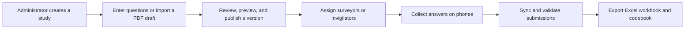

# Research-Tool

An open-source research data collection platform: create questionnaires, give field surveyors access, collect answers on phones, and export analysis-ready Excel workbooks.

**Status: development pilot.** The repository now contains a Rust server, a responsive web application, account activation, a questionnaire editor, versioned publication, field collection with an offline outbox, reviewed question-candidate import, and real Excel exports. The broader requirements below remain the product direction; see the [development guide](docs/development.md) for the implemented scope and current limits. Use fictional data while evaluating the pilot.

## Run it

Install Rust 1.90.0, Node.js 20+ with npm, native build tools, Python 3, and Poppler (`pdftotext` and `pdfinfo`), then run:

```bash
./scripts/setup.sh
./scripts/start.sh
```

The built website and API use the same server, initially on port 3000. On a fresh database, the initial login ID is `admin`; the script saves a random initial password in private, ignored `.local/admin-password`. Read that file locally to sign in. Existing accounts and responses survive restarts.

Start with the editable example study, or create an entirely new study from **New study**. Review a questionnaire, publish it, create surveyor access in **Research team**, and collect answers in **Field collection**. Each surveyor activates their own account using a one-time code and sets their own password. Export the collected answers from **Responses & exports**.

See [development and verification instructions](docs/development.md) for configuration, hot reload, tests, HTTPS/phone installation, and retained data.

## The idea

Researchers should be able to turn a questionnaire into a reliable field collection workflow without manually copying every answer into a spreadsheet. An administrator prepares the study and its questions; authorized surveyors record participants' answers; the researcher receives structured data to analyze using their preferred tools.

The same website should work in a desktop browser, a phone browser, and as an installable progressive web app (PWA). Installation and offline capabilities depend on the browser; ordinary browser access remains available.



## Questions and answers

| Question | Planned answer |
| --- | --- |
| Who creates the study? | An administrator creates projects, edits questionnaires, assigns surveyors, and exports their project's data. |
| Who collects the answers? | Surveyors or student invigilators sign in using assigned IDs, such as institution roll numbers, and a secure authentication method. An ID alone is not a password. |
| Can researchers edit everything? | Questions, choices, sections, instructions, and validation are editable in drafts. Published versions remain fixed so collected answers retain their original meaning. Changes produce a new version. |
| Can a PDF become a questionnaire? | The pilot finds question candidates in a text-based PDF or pasted numbered text. The researcher must compare it with the original and correct missing text, question types, choices, consent, and logic before publication. Complex tables and scales require manual work; scanned PDFs and OCR come later. |
| Can it work without a connection? | After online sign-in and downloading a form, a surveyor should be able to save answers locally and sync later. Offline data stays pending until the server acknowledges it. |
| What does the researcher receive? | An `.xlsx` workbook with one row per submitted response, stable columns for answers and subanswers, choice codes, and a codebook explaining the fields. |
| Does it analyze the research? | The initial product organizes and exports answers. Statistical analysis, interpretation, and claims remain with the researcher. |
| Is everything public? | The source code is open under the [MIT license](LICENSE). Participant answers and research datasets remain private to authorized users. |

## First release

- Administrator and surveyor interfaces with project-specific access; “invigilator” initially uses the surveyor role.
- Manual questionnaire authoring with sections, common question types, required fields, validation, and simple branching.
- Text-based PDF import into an unpublished draft, with an explicit review step.
- Administrator-created surveyor accounts and project assignments, with browser and installed-web-app access.
- Phone-friendly collection, local drafts, offline submission queues, and duplicate-safe synchronization.
- Versioned questionnaires and stable answer codes so edits cannot silently reinterpret existing responses.
- Excel response exports and a codebook suitable for use in Excel, R, Python, SPSS, or other analysis tools.

Repeating groups, scanned-document OCR, public participant links, attachments, advanced analysis, and XLSForm interoperability are later additions. See the [roadmap](docs/roadmap.md) for the delivery order and release checks.

## Product and technical documents

| Document | Purpose |
| --- | --- |
| [Product requirements](docs/product-requirements.md) | Roles, authoring and collection workflows, limits, and acceptance criteria. |
| [Architecture](docs/architecture.md) | Proposed Rust API, database, PWA, authentication, and offline synchronization. |
| [Data and exports](docs/data-and-exports.md) | Answer structure, example questionnaire, spreadsheet columns, and export rules. |
| [Roadmap](docs/roadmap.md) | Implementation milestones and the checks needed before field use. |
| [References](docs/references.md) | Lessons from official KoboToolbox and related documentation. |
| [Design inspirations](docs/design-inspirations.md) | Which ideas from established research tools inform each implementation phase. |
| [Legacy recovery](docs/legacy-recovery.md) | Source-backed lessons from CivicAge and the REA investigation guidance. |
| [Study context](docs/study-context.md) | The supplied ICSSR review document, its instrument structure, and unresolved protocol questions. |
| [Verification](docs/verification.md) | Executed development checks, synthetic-data validation, and remaining deployment checks. |
| [Contributing](CONTRIBUTING.md) | How to help turn this blueprint into a working application. |

## Implementation and next steps

The pilot uses a **Rust/Axum API**, **SQLite**, and a **React/Vite PWA** with IndexedDB for pending field work. Bundled SQLite removes the need to configure a separate database for local development and small self-hosted pilots. PostgreSQL and TypeScript remain future migration options; language choice alone is not a performance guarantee.

The engine is universal: study names, locations, questions, choices, and rules are editable. “Smart Cities, Silent Citizens” is an **unapproved example workspace**, not a restriction on other research. The uploaded 60-page instrument is marked for review/pilot testing; conflicting city lists, eligibility, and scoring need researcher confirmation. Neither the sample nor imported candidates are presented as approved ICSSR instruments.

Current limits include project-wide collector assignments, no administrative password recovery/revocation interface, no response-correction UI, no advanced export filters, no OCR or repeating groups, and no tested production backup/hosting operations. The pilot exports separate worksheets per immutable form version to prevent unrelated question codes from being mixed. There is no external AI dependency, billing, advertising, or telemetry in this implementation. Self-hosting still needs infrastructure and administration. See the [roadmap](docs/roadmap.md) before planning real field deployment.
