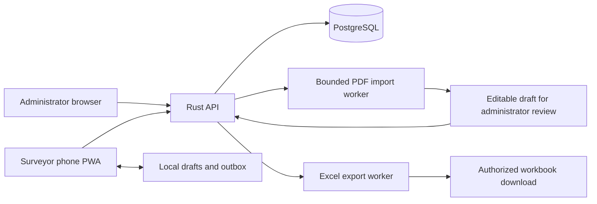

# Proposed architecture

This is the target architecture. The first implementation uses Rust/Axum, bundled SQLite, and a React/Vite JavaScript PWA with IndexedDB. PostgreSQL and TypeScript below remain future options. See the [working API contract](api-contract.md) and [development guide](development.md) for actual routes, setup, and implementation boundaries; response revisions, review-state editing, and the complete logical model below remain roadmap work.

## Technology direction

| Component | Proposed choice | Purpose |
| --- | --- | --- |
| Browser application | TypeScript, React, Vite | Administrator form builder and responsive surveyor screens |
| Installable web app | Web app manifest, service worker, IndexedDB | Phone home-screen installation where supported, cached application and forms, local drafts and submission queue |
| Server | Rust with Axum | Authentication, permission checks, questionnaire validation, synchronization, import, and export |
| Database | PostgreSQL | Users, project membership, immutable published forms, answers, and audit records |
| Import processing | Isolated native-text PDF parser | Extract candidate questions into an unpublished draft |
| Export processing | XLSX writer | Produce typed Excel workbooks and a question codebook |
| File storage | Private local storage initially; replaceable object storage later | Temporary imports and generated exports with controlled retention |

Rust fits the requested backend direction. TypeScript is the practical browser language; an all-Rust browser application is not a prerequisite. Ease of installation, accessibility, and dependable synchronization matter more than theoretical language benchmarks. Select and pin exact versions and libraries during implementation after checking maintenance, licenses, platform support, and file-handling behavior.

The first implementation should use one backend and one database, without microservices. Slow imports and exports need bounded background work so they cannot block ordinary submissions. A separate queue service is unnecessary until measured workload justifies it.

## Component flow

Serve the application and API from the same HTTPS origin where practical. HTTPS is needed for normal service-worker deployment. Installation behavior varies by browser and operating system; the website must remain fully usable without installation. Do not promise background synchronization or unlimited offline storage on every phone.

## Access and project isolation

- An administrator creates a project, edits forms, publishes versions, assigns surveyors, reviews submissions, and exports project data.
- A surveyor works only on assigned projects and questionnaires, maintains their own drafts, and submits collected answers. “Invigilator” is an alternate label for this role in the MVP, not a separate permission level.
- A roll number or staff ID is a login identifier, not a password or authorization credential. Administrators provision accounts through a time-limited activation flow; passwords are stored as salted password hashes using a suitable algorithm such as Argon2id.
- Enforce project membership and object access on every server request, including import files and export downloads. Hiding controls in the browser is insufficient.
- Prefer secure, HttpOnly session cookies with appropriate SameSite settings and CSRF protection. Do not store long-lived server credentials in IndexedDB or the service-worker cache.
- Log administrative changes and submission corrections with actor, time, and reason. Preserve original answers when corrections are introduced.

Login identifiers are unique within the hosted instance in the MVP; allow a team prefix when using roll numbers. Do not treat an institution's roll number as globally unique. A future institution-scoped login needs an explicit institution selector or equivalent.

## Questionnaire lifecycle and PDF import

1. An administrator creates an editable draft manually or uploads a PDF.
2. The importer processes the file with size, page, time, and memory limits. Treat the file as untrusted input and keep it private.
3. Native text becomes candidate questions, choices, sections, and instructions. Flag ambiguous layouts and unsupported items instead of guessing silently. An image-only PDF must produce a clear explanation that OCR is not supported in the MVP.
4. The administrator checks wording, question IDs, data types, choices, required fields, and simple skip conditions in an editable preview. Import never publishes automatically.
5. Server validation and explicit administrator approval publish an immutable version.
6. Edits to a published form create a new draft and subsequently a new version. Existing responses continue referencing their original version.

OCR, automatic interpretation of complex tables, repeated groups, attachments, GPS questions, and XLSForm interchange are later extensions. Importing question definitions and exporting response workbooks are separate operations, even when both later support spreadsheet formats.

## Offline collection and synchronization

The surveyor must first sign in online and download their assigned published form. New-account login, first-time form access, permission changes, and administrator workflows require a connection in the MVP.

The PWA caches its application shell and form definitions. IndexedDB holds local drafts and a durable outbox; the interface distinguishes **draft**, **queued on this device**, **submitted to server**, and **needs attention**. Saving locally is never presented as a server submission. Warn before clearing local data or signing out with unsent work. Explain that browser storage can be removed by the user, the operating system, or private-browsing rules.

Each submission has a client-generated UUID, project ID, immutable form-version ID, collection timestamps, and answers keyed by stable question IDs. On synchronization:

1. Authenticate and recheck current project membership and assignment.
2. Validate the payload against its referenced published schema, not the latest schema.
3. Accept the entire response atomically and return a server receipt.
4. Use a uniqueness constraint on the submission ID so retries cannot create duplicate rows. Return the existing receipt for an identical retry; reject conflicting content under the same ID.
5. Clear the outbox entry only after receipt acknowledgment. Preserve rejected answers locally with an actionable error.

Corrections use a separate administrator-only revision operation, not a modified retry of the original submission. Validate the correction against the original form version, require a reason and the expected current revision, and preserve the original payload. Export the latest authorized revision at the export snapshot cutoff and retain its revision number; conflicting concurrent corrections must be resolved explicitly.

Publishing a new version does not automatically invalidate downloaded versions. The administrator must explicitly close an old version to new submissions. If a project is closed, an assignment revoked, or a form retired while a phone is offline, synchronization must reject unauthorized new submissions without silently deleting the local work. The UI should show what action the surveyor needs to take.

Local device access is distinct from server authentication. Offline continuation is limited to a previously initialized device and needs an explicit device-access policy before implementation. Protect sensitive local storage according to the study's requirements, avoid shared unlocked devices, and do not claim browser storage provides encryption or remote erasure. Immediate revocation cannot reach a disconnected device.

## Minimal logical data model

| Record | Responsibility |
| --- | --- |
| User | Login identifier, password hash, account status |
| Project | Study name, owner, collection and retention settings |
| Membership | User, project, role, assignment status |
| Questionnaire | Project-owned identity for a form across revisions |
| FormDraft | Editable schema, import warnings, and administrator review state |
| FormVersion | Version number, published schema, choice codes, publication/closure state |
| FormAssignment | Surveyor, questionnaire, assigned version, and active/closed state |
| ImportJob | Uploaded-file reference, extraction status, warnings, reviewed draft reference |
| Response | Unique submission ID, project, form version, surveyor, collection and server receipt times, review status |
| Answers | Typed values keyed by question ID, including explicit absence status |
| AuditEvent | Actor, project, action, record reference, timestamp, change reason |
| ResponseRevision | Original response reference, corrected values, author, time, and reason; retain original submission |
| ExportJob | Requester, project, selected versions, snapshot cutoff, file status and expiry |

Answer storage may begin as schema-validated JSONB attached to a response; the relational identifiers and constraints still enforce ownership, version references, and retry uniqueness. Future reporting tables can be derived without changing the original response. Separate personally identifying information from general survey answers when a study requires it.

## API outline for implementation

These paths illustrate responsibilities; they are not available endpoints.

| Capability | Example route |
| --- | --- |
| Activate account, sign in/out | `POST /api/auth/activate`, `/api/auth/login`, `/api/auth/logout` |
| Create projects and provision surveyors | `POST /api/projects`, `POST /api/projects/{project_id}/members` |
| Save questionnaire draft | `PUT /api/projects/{project_id}/forms/{form_id}/draft` |
| Import PDF and inspect extraction | `POST /api/projects/{project_id}/imports`, `GET /api/projects/{project_id}/imports/{import_id}` |
| Publish a reviewed form | `POST /api/projects/{project_id}/forms/{form_id}/publish` |
| Download assigned form version | `GET /api/projects/{project_id}/forms/{form_id}/versions/{version_id}` |
| Submit or retry one response | `POST /api/projects/{project_id}/responses` |
| Record an audited administrator correction | `POST /api/projects/{project_id}/responses/{response_id}/revisions` |
| Request and download an export | `POST /api/projects/{project_id}/exports`, `GET /api/projects/{project_id}/exports/{export_id}` |

Define request schemas, authorization, error codes, upload limits, pagination, rate limits, and export retention before treating the API as stable. Never log passwords, activation tokens, or full sensitive answer payloads.

## Deployment and implementation gates

Plan a self-hostable release with documented configuration, database migrations, backup and restore instructions, health checks, and HTTPS termination. Retained files and databases must survive service restarts; live processes and sessions do not constitute durable storage. Demonstrate recovery from a backup before claiming production readiness.

Before choosing packages or reusing source, audit dependency licenses and security maintenance. This project's MIT license does not authorize copying differently licensed KoboToolbox, ODK, or other source into it. Use their documented behavior as inspiration; evaluate any actual code reuse under its own license.

Implementation validation must include cross-project access denial, offline save/reload, network interruption during synchronization, duplicate retries, revoked assignments, closed form versions, reviewed import publication, and the export checks in [Data and Excel exports](data-and-exports.md). No performance, deployment, or security claims are validated by this design document alone.
